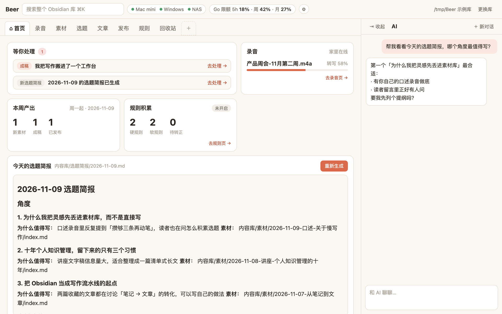
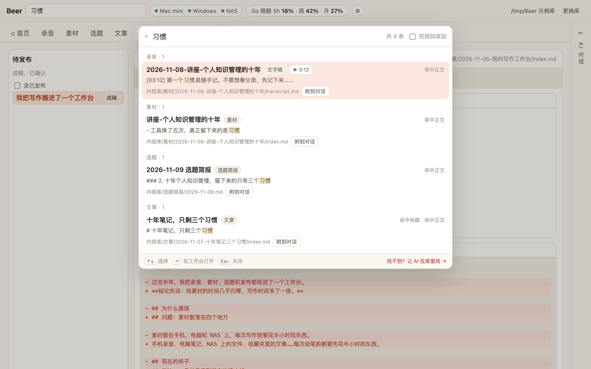
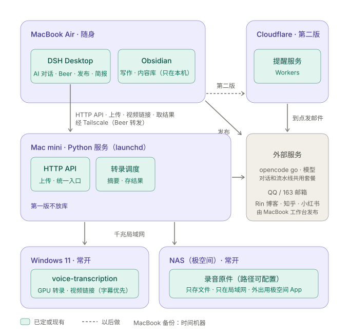

# Beer Platform

**一个从录音到发布的个人写作工作台，跑在 [DSH Desktop](https://dshdesktop.com) 里。**

录一段音，它自己转写、摘要、进素材库；每天早上给你一份选题简报；你写主稿，它按知乎、小红书的风格改写，确认一次就发出去。所有内容都是 Obsidian 库里的 Markdown 文件，AI 对话就在旁边随时可用。

<p align="center">
  
</p>

这也是一份完整的 **DSH Desktop 工作台参考实现**：整页布局、宿主原生对话、注册给 AI 的工具、钥匙串密钥、按需加载的前端模块，都有可以直接对照的代码。欢迎参考，或者拆出其中的模块来用。

## 亮点

- **从录音到发布一条线。** 首页、录音、素材、选题、文章、发布、规则、回收站 8 个分页，覆盖写作的每一步；还能用「＋」把库里任意文件夹加成自定义分页。
- **内容永远是你的文件。** 素材、选题简报、文章、平台版本、规则都是 Obsidian 库里的普通 Markdown，换工具也带得走。Beer 不建数据库，在 Obsidian 里改了，Beer 里马上看到。
- **AI 帮忙，但不替你写。** 选题简报里 AI 只提角度，主稿由你自己写；文章页的「列提纲、查事实、提反对意见、拟标题」只是把提示放进对话草稿，发不发由你决定。
- **一稿多发，改动看得见。** 成稿后自动生成知乎版和小红书版，和主稿逐行对照。你手改过的版本不会被覆盖；Rin 博客一键发布，知乎、小红书一键备好发布包。
- **越用越懂你的风格。** 规则学习会对比你改过的平台版本，归纳写作偏好；同一条观察到 3 次才转为正式规则，下次生成时自动遵守。
- **录音交给家里的机器。** 外出时录音经 Tailscale 传回家里的 Mac mini，转写、按类型（会议、口述灵感、课程讲座）摘要、存 NAS、发邮件通知，全部自动完成。上传 1 GB 的录音也只占几 MB 内存。B 站、YouTube 视频链接也能直接贴，先取字幕，没有再转写音轨。
- **日程和邮件提醒。** 首页有「日程与待办」和月历，日程存在库根目录的 `日程.md`（Obsidian Tasks 写法，手机上也能看、能勾）；一句话快速添加，贴一封面试邮件交给 AI 解析、复述确认后再建；支持重复日程。到点由 Cloudflare 上的提醒服务发邮件，MacBook 关机也不耽误。
- **对话里也能用。** 注册了 `beer_transcribe_submit / status / result` 三个工具，在 DSH 对话里说一句「帮我转写这段录音」就行。
- **全库搜索 ⌘K。** 文章、素材、文字稿、选题简报一起搜，支持 `#标签`、`状态:`、`类型:`；命中文字稿时可以直接从那一秒开始播放。
- **改坏了也不怕。** 保存前检查版本，别处改过就提示冲突、不覆盖；删除先进回收站，只有手动清空才真正删除；密钥只存在 macOS 钥匙串里。

## 截图

| | |
|---|---|
| <br>**首页**：待处理、录音进度、本周产出、今天的选题简报（截图是 0.1.13 的，新版首页多了日程与待办） | <br>**录音**：拖进来就上传，五步进度、播放、按类型重做摘要 |
| <br>**选题**：每天一份简报，一键建选题或交给 AI 讨论 | <br>**文章**：状态流转、实时预览编辑、AI 帮手 |
| <br>**发布**：主稿和各平台版本逐行对照，确认一次就发 | <br>**搜索**：⌘K 搜全库，文字稿命中可直接定位播放 |

## 不装 DSH Desktop，先跑起来看看

```bash
cd beer && npm ci && npm run demo
```

打开 <http://127.0.0.1:4173>。演示模式用的是**真实的 Beer 后端**，加一份虚构的示例库，家里服务和模型接口用示例数据代替。上面的截图和 GIF 都是在演示模式里录的。

## 组成

| 目录 | 是什么 | 技术 |
|---|---|---|
| [`beer/`](beer/README.md) | DSH Desktop 工作台包 `beer-workbench`：面板、业务接口、AI 工具 | Node.js ≥ 22，手写 ESM，**零第三方运行时依赖**；面板是单文件 React，不需要构建 |
| [`beer/demo/`](beer/demo/server.js) | 演示模式：浏览器里直接看面板 | 同上 |
| [`cloud/reminder/`](cloud/reminder/README.md) | 云端提醒服务：存提醒、每分钟检查、到点发邮件 | Cloudflare Worker + D1 |
| [`home/`](home/README.md) | 家里服务：接收录音、调度转写、摘要、邮件通知、原件存 NAS（WebDAV） | Python ≥ 3.12，FastAPI，uv |
| [`GLOSSARY.md`](GLOSSARY.md) | 项目术语表（分页、条目、选题、平台版本……） | |
| [`docs/`](docs/) | 架构图、截图、早期布局稿 | |

<p align="center"></p>

## 开发

```bash
cd beer && npm ci && npm test          # 395 个测试，node --test
cd home && uv sync && uv run pytest    # 108 个测试
cd cloud/reminder && npm ci && npm test   # 13 个测试
```

每个业务模块是 `beer/src/modules/` 下的一个文件，在 `modules/index.js` 里登记，后端和宿主无关：`createBeerHandler()` 返回普通的 `(req, res)` 处理函数，测试和演示模式都直接用它起服务。打包、装进 DSH Desktop、配置钥匙串密钥见 [beer/README.md](beer/README.md)；家里服务的部署（macOS LaunchDaemon）见 [home/README.md](home/README.md)。

## 局限性

- **依赖 DSH Desktop。** 正式使用要在 DSH Desktop（目标 0.13.2，dsh 运行时 0.2.2-alpha.2）里安装；宿主接口变化时可能需要跟着改。
- **只在 macOS 上跑过。** 密钥用 macOS 钥匙串，家里服务按 LaunchDaemon 部署。
- **转写服务要自备。** 家里服务通过 HTTP 调用一个外部转写服务（BeeBox，接口见 `home/src/home_service/beebox.py`），仓库里不包含转写模型。
- **模型接口按 opencode go 写的。** 调用的是 OpenAI 兼容的 `chat/completions`，限额显示用的是 opencode go 自己的接口。
- **发布平台是固定的。** 自动发布只支持 Rin 博客；知乎、小红书是准备发布包，由你粘贴后手动点发布。
- **界面和文档都是中文。**
- 文档里的 `#11`、`#19` 等编号指原开发仓库的 Issue；部署文件里的 `you`、`com.example`、`100.x.y.z`，以及提醒服务的 `remind.example.com`、`<your-d1-database-id>` 是占位符。

## 许可证

[MIT](LICENSE)。`beer/client/editor.js` 打包了 CodeMirror 等第三方代码，许可证见 [beer/THIRD_PARTY_NOTICES.md](beer/THIRD_PARTY_NOTICES.md)。
