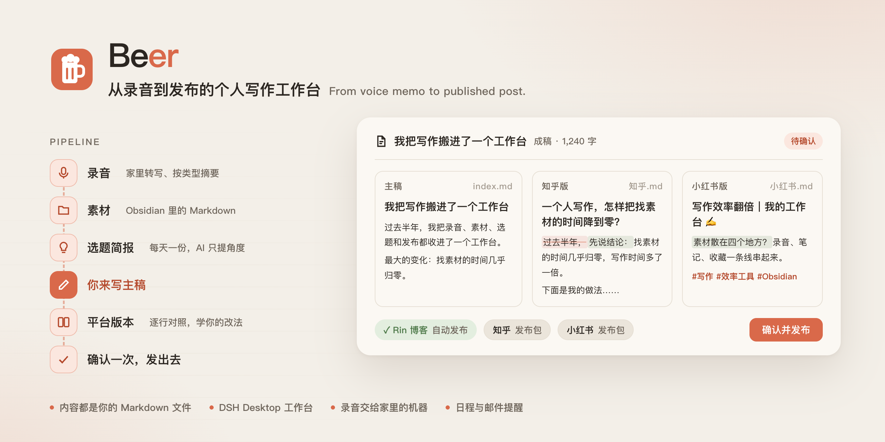
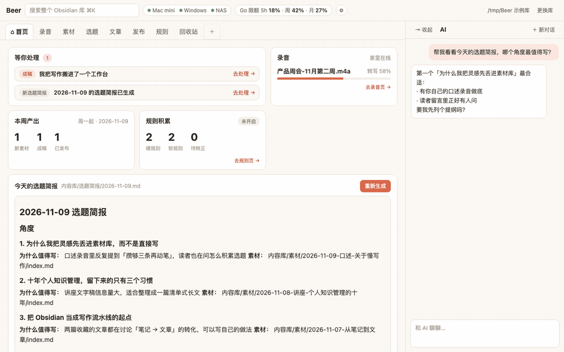
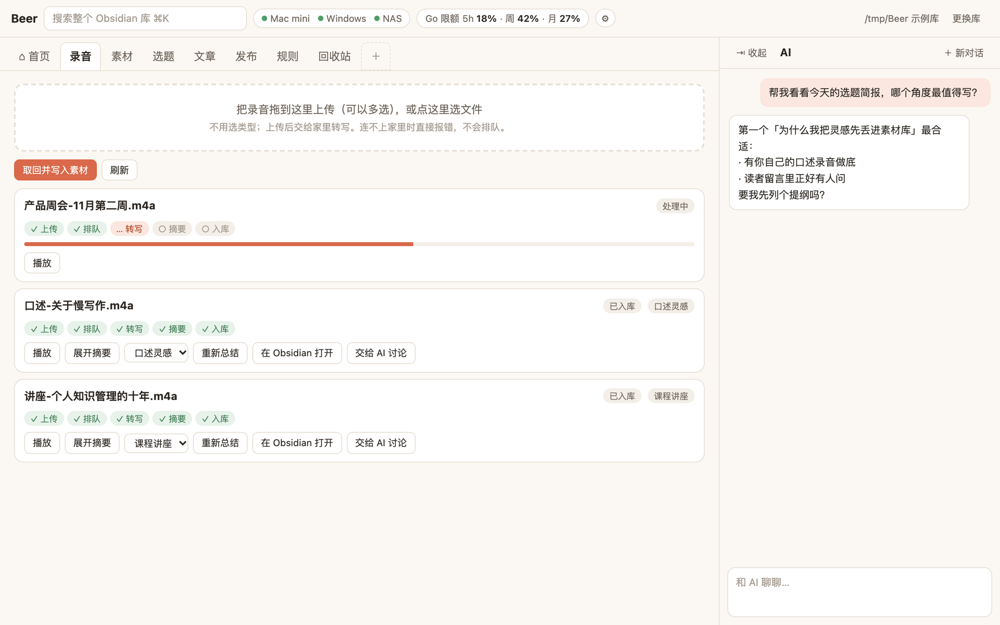
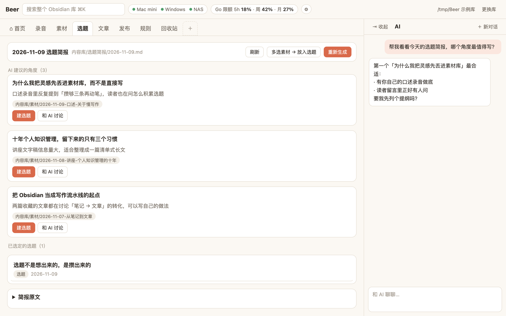
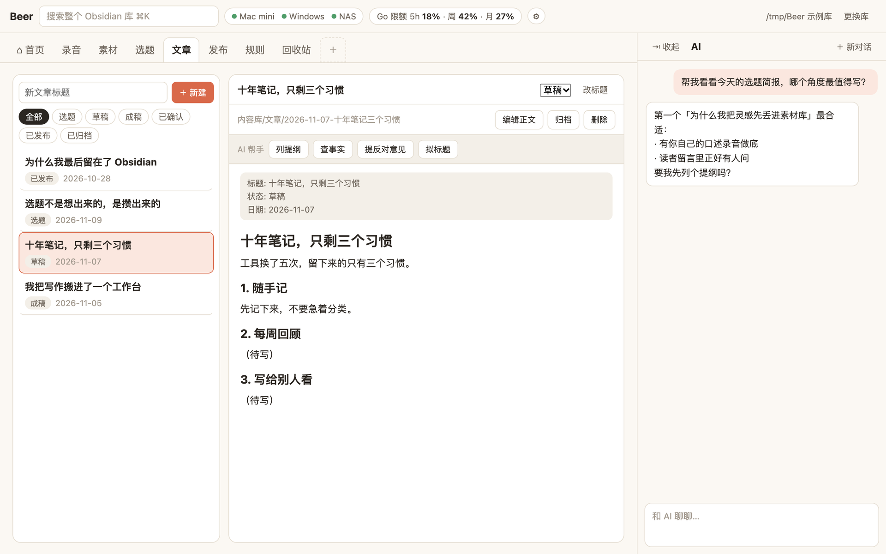
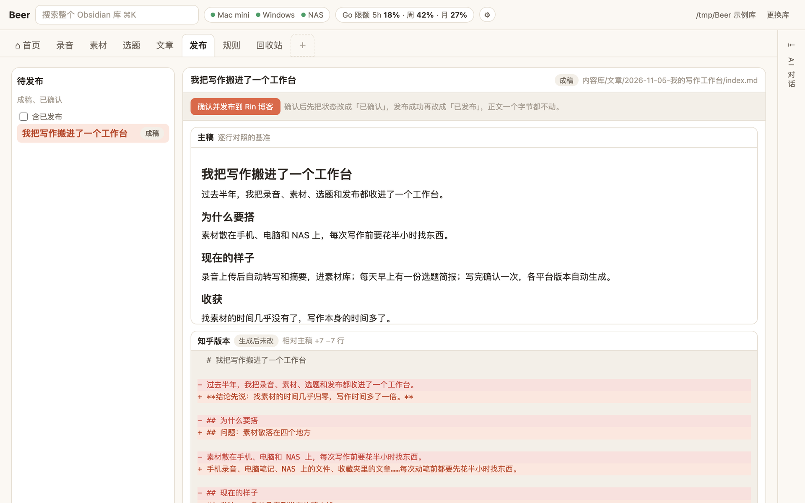
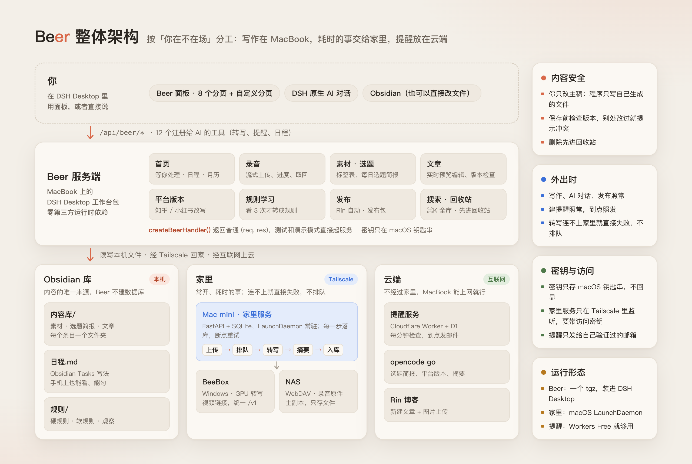

<div align="center">

<picture>
  <source media="(prefers-color-scheme: dark)" srcset="docs/assets/banner-dark.png">
  
</picture>

**从录音到发布的个人写作工作台，跑在 [DSH Desktop](https://dshdesktop.com) 里。**

录一段音，它自己转写、摘要、进素材库；每天给你一份选题简报；你写主稿，它按知乎、小红书的风格改写，确认一次就发出去。<br>
所有内容都是 Obsidian 库里的 Markdown 文件，AI 对话就在旁边。

<p><a href="LICENSE"></a>   </p>

<p><a href="https://github.com/HUA1255/beer-platform/releases/latest">下载安装包</a> · <a href="#快速上手">快速上手</a> · <a href="#ai-agent-部署指南">AI Agent 部署</a> · <a href="#整体架构">整体架构</a> · <a href="#已知限制">已知限制</a> · <a href="beer/README.md">Beer 详细文档</a></p>

</div>

---

## 为什么选 Beer

| | |
| --- | --- |
| 📝 **内容永远是你的文件** | 素材、选题简报、文章、平台版本、规则、日程都是 Obsidian 库里的普通 Markdown。Beer 不建数据库，在 Obsidian 里改了，Beer 里马上看到 |
| 🎙️ **录音交给家里的机器** | 外出录的音经 Tailscale 传回家，转写、按类型（会议、口述灵感、课程讲座）摘要、原件存 NAS、发邮件通知，全部自动完成 |
| 🔗 **视频链接直接贴** | B 站、YouTube 链接交给 [BeeBox](https://github.com/HUA1255/beebox)：有平台字幕直接用，没有才下载音轨转写，结果和录音一样进素材库 |
| 💡 **AI 帮忙，但不替你写** | 选题简报里 AI 只提角度，主稿由你自己写；「列提纲、查事实、提反对意见、拟标题」只是把提示放进对话草稿，发不发你说了算 |
| ✅ **一稿多发，只确认一次** | 成稿后生成知乎版和小红书版，和主稿逐行对照。确认一次：Rin 博客自动发布，知乎、小红书备好发布包 |
| 🧠 **越用越懂你的风格** | 对比你改过的平台版本，归纳写作偏好；同一条观察到 3 次才转为正式规则，下次生成时自动遵守 |
| 📅 **日程和提醒在同一个库里** | 日程存在 `日程.md`（Obsidian Tasks 写法），一句话快速添加、重复日程、拆步骤；到点由 Cloudflare 发邮件，MacBook 关机也不耽误 |
| 💬 **对话里也能用** | 注册了 12 个 AI 工具：转写、存素材、建提醒、管日程。在 DSH 对话里说一句「周五下午三点提醒我交稿」就行，改动前先复述、等你确认 |
| 🔍 **全库搜索 ⌘K** | 文章、素材、文字稿、选题简报一起搜，支持 `#标签`、`状态:`、`类型:`；命中文字稿时可以直接从那一秒开始播放 |
| 🛡️ **改坏了也不怕** | 保存前检查版本，别处改过就提示冲突、不覆盖；删除先进回收站；密钥只存在 macOS 钥匙串里 |

## 实测表现

数据来自作者自己的日常使用环境（MacBook + Mac mini + Windows 显卡机 + 极空间 NAS）和仓库里的测试：

- **1 GB 录音上传**：Beer 转发给家里时守背压，进程只占几 MB 内存。Node 自带的 `fetch` 发流式请求体时不守背压，同样的文件会在进程里攥住约 1 GB，所以上传改用 `node:http` + `pipeline`。
- **录音原件存 NAS**：局域网 WebDAV `PUT` 2 MB 约 0.08 秒、50 MB 约 0.75 秒，回读哈希一致。SMB 挂载在 macOS 上反复挂载后会陷入僵死会话，所以没用。
- **有字幕的视频链接**：BeeBox 直接用平台字幕，几秒出文字稿，不进显卡队列。
- **邮件提醒**：到点后 1 分钟内发出；发信失败按 1、2、4、8、16 分钟重试，一共试 6 次。Cloudflare Workers 免费版就够用。
- **测试**：Beer 395 个接口测试，家里服务 108 个，提醒服务 13 个，都不需要真实的家里机器、模型或网络。
- **安装包**：Beer 打包后约 450 KB（宿主上限 8 MiB），**零第三方运行时依赖**。

## 适合用来做什么

- **个人写作和自媒体**：素材、选题、写作、多平台发布在一条线上，内容始终是自己的文件。
- **把录音变成素材**：会议、讲座、路上冒出来的想法，录完就不用管，摘要和文字稿自动进库。
- **视频笔记**：把 B 站、YouTube 上的课程和访谈变成可搜索、可引用的素材。
- **写作和日程放在一起**：截稿、面试、录制计划和文章在同一个库里，到点有邮件提醒。
- **DSH Desktop 工作台参考实现**：整页布局、宿主原生对话、注册给 AI 的工具、钥匙串密钥、按需加载的前端模块，都有可以直接对照的代码。

Beer 专注把素材整理好、把发布这一步做省事，**主稿始终由你自己写**。

## 界面一览

<p align="center">
  
</p>

| | |
|---|---|
| <br>**录音**：拖进来就上传，五步进度、播放、按类型重做摘要 | <br>**选题**：每天一份简报，一键建选题或交给 AI 讨论 |
| <br>**文章**：状态流转、实时预览编辑、AI 帮手 | <br>**发布**：主稿和各平台版本逐行对照，确认一次就发 |

GIF 是 0.1.22 的演示模式录的；四张截图是 0.1.13 的，这几个分页的布局没变。

---

## 目录

1. [快速上手](#快速上手)
2. [AI Agent 部署指南](#ai-agent-部署指南)
3. [方案选型与理由](#方案选型与理由)
4. [整体架构](#整体架构)
5. [已知限制](#已知限制)
6. [以后可能做的](#以后可能做的)
7. [配置、接口与开发](#配置接口与开发)

> 代码和文档里的 `#11`、`#19` 等编号指原开发仓库的 Issue（不公开）；部署文件里的 `you`、`com.example`、`100.x.y.z`、`remind.example.com`、`<your-d1-database-id>` 是占位符。

---

## 快速上手

### 不装 DSH Desktop，先跑起来看看

```bash
cd beer && npm ci && npm run demo
```

打开 <http://127.0.0.1:4173>。演示模式用的是**真实的 Beer 后端**，加一份虚构的示例库；家里服务和模型接口用示例数据代替，时钟固定从当天 14:20 起走。上面的 GIF 和截图都是在演示模式里录的。

### 正式使用

**运行要求**：macOS、[DSH Desktop](https://dshdesktop.com)（目标 0.13.2，内置 dsh 运行时 0.2.2-alpha.2）、一个 Obsidian 库；自己从源码打包时另需 Node.js 22+。录音转写另需家里服务和 BeeBox，邮件提醒另需一个 Cloudflare 账号，都可以以后再加。

**1. 下载安装包**：在 [Releases](https://github.com/HUA1255/beer-platform/releases/latest) 下载最新的 `beer-workbench-x.y.z.tgz`，不需要克隆仓库、也不需要装 Node。用命令行下载也可以：

```bash
gh release download --repo HUA1255/beer-platform --pattern 'beer-workbench-*.tgz'
```

想自己从源码打包也可以（用 DSH Desktop 自带的 pnpm，结果和 Releases 里的一样）：

```bash
cd beer
npm ci && npm test
node "/Applications/DSH Desktop.app/Contents/Resources/app.asar.unpacked/node_modules/pnpm/bin/pnpm.cjs" pack
```

**2. 安装**：在 **DSH Desktop 里的 Agent** 对话中让它调用（外部的 Claude Code 等调不到这个工具）：

```text
install_local_workbench({ path: "<beer-workbench-x.y.z.tgz 的绝对路径>", replace: false })
```

返回 `applied` 就能用；`restart-required` 时点顶部提示的「立即重启」。以后升级：下载新版本的 tgz，用 `replace: true` 再装一次（自己打包时记得先升 `package.json` 里的 `version`）。

**3. 第一次打开**：从左侧入口打开 Beer，选你的 Obsidian 库；点顶栏齿轮，在设置弹层里填需要的密钥（存进 macOS 钥匙串，不回显）。

完整的打包核对、安装验收清单见 [beer/README.md](beer/README.md)。

---

## AI Agent 部署指南

Beer 的构建、测试、打包和三个服务的部署都可以交给 Claude Code、Codex 等编程 Agent 来做。**安装进 DSH Desktop 这一步必须在 DSH Desktop 自己的 Agent 里完成**，填密钥、登录第三方账号这类事必须由你本人来做。

### 发给 Agent 的提示词

在 MacBook 上打开 Agent，把下面这段话发给它：

```text
请在这台 Mac 上部署 Beer（https://github.com/HUA1255/beer-platform）。
先完整阅读仓库 README.md 的「AI Agent 部署指南」和 beer/README.md，再按步骤执行。
规则：
1. 需要 sudo、会注册系统服务、会登录第三方账号（Cloudflare 等）的步骤，先说明要做什么，等我确认后再执行。
2. 每一步都用指南里的检查方法确认结果，失败时先看输出和日志定位原因，不要跳过或绕过检查。
3. 不要打印、记录或提交任何密钥；钥匙串里的值、home-service.env、wrangler secret 都由我自己填。
4. 完成后告诉我：Beer 包的版本和路径、测试结果、哪些可选服务装了、还剩哪些需要我自己做的步骤。
```

### Agent 执行步骤

以下步骤写给 Agent 看。每一步都有「检查」项，满足后再进入下一步。

**1. 检查环境（只读）**

```bash
sw_vers                     # macOS
ls -d "/Applications/DSH Desktop.app"
gh --version                # 下载 Releases 用
node --version              # 22 或更高；只在从源码打包、部署提醒服务时需要
```

检查：前三条正常输出。缺 DSH Desktop、gh 或 Node 时先告诉用户，由用户决定是否安装（没有 gh 也可以在浏览器里从 Releases 页面下载）。

**2. 获取代码**

```bash
git clone https://github.com/HUA1255/beer-platform.git
cd beer-platform
git checkout $(git describe --tags --abbrev=0)   # 切到最新发布版本
```

检查：`git status` 干净，当前在形如 `v0.1.22` 的 tag 上。家里服务和提醒服务要从这份代码部署；只装 Beer 的话也可以跳过 clone，直接用第 3 步的下载。

**3. 准备安装包**

默认直接下载 Releases 里的包，并核对校验值（Release 说明里写了 SHA-256）：

```bash
gh release download --repo HUA1255/beer-platform --pattern 'beer-workbench-*.tgz'
shasum -a 256 beer-workbench-*.tgz
tar -tzf beer-workbench-*.tgz | head -20
```

用户要求从源码构建时改为：

```bash
cd beer && npm ci && npm test       # 全部通过（0.1.22 为 395 个）
node "/Applications/DSH Desktop.app/Contents/Resources/app.asar.unpacked/node_modules/pnpm/bin/pnpm.cjs" pack
```

检查：SHA-256 与 Release 说明一致（下载时）；包里有 `package/package.json`、`package/src/index.js`、`package/client/beer-client.js`、`package/cordis.patch.yml`，没有 `test/`、`node_modules/`；tgz 小于 8 MiB。

**4. 安装（交给用户在 DSH Desktop 里做）**

把 tgz 的绝对路径告诉用户，请用户在 DSH Desktop 里新开对话，让 DSH 的 Agent 调用 `install_local_workbench({ path, replace: false })` 并按宿主审批确认。

检查（安装后）：

```bash
dsh --profile web --dump-config | grep -n beer   # 能找到 beer 插件层
```

**5. 填密钥（由用户做）**

请用户打开 Beer 面板顶栏的齿轮，按需填写：

| 账号名 | 什么时候需要 |
| --- | --- |
| `opencode-go-api-key` | 选题简报、平台版本、限额显示（模型调用） |
| `home-api-key` | 用家里服务转写录音 |
| `reminder-api-key` | 用邮件提醒 |
| `rin-admin-username` / `rin-admin-password` | 自动发布到 Rin 博客 |

检查：设置弹层里对应的密钥显示「已存」。

**6. 可选：家里服务（在 Mac mini 上，需要 sudo，先征得用户确认）**

按 [home/README.md](home/README.md) 的部署步骤：`uv sync --frozen --no-dev`，复制 `deploy/home-service.env.example` 到 `/usr/local/etc/home-service.env`（权限 600，**由用户填写**访问密钥、NAS 的 WebDAV、BeeBox 地址和 token），把 `deploy/com.example.home-service.plist` 里的占位符换成实际值后装成 LaunchDaemon。

检查：

```bash
cd home && uv run pytest -q                                              # 108 个测试通过
curl -H "Authorization: Bearer <密钥>" http://<Mac mini 的 Tailscale IP>:8787/health
```

`/health` 里 `machines.mac_mini / windows / nas` 的 `online` 都为 `true`。BeeBox 的部署见 [HUA1255/beebox](https://github.com/HUA1255/beebox) 自己的 AI Agent 部署指南。

**7. 可选：邮件提醒（需要登录 Cloudflare，先征得用户确认）**

```bash
cd cloud/reminder
npm ci && npm test                        # 13 个测试通过
npx wrangler login                        # 由用户在浏览器里完成
npx wrangler d1 create beer-reminder      # 把 database_id 填进 wrangler.toml
npx wrangler d1 migrations apply beer-reminder --remote
npx wrangler deploy
```

把 `wrangler.toml` 里的 `remind.example.com` 换成用户自己域名的子域名；`REMINDER_TOKEN`、`MAIL_FROM`、`MAIL_TO` 用 `wrangler secret put` **由用户输入**，同一个 `REMINDER_TOKEN` 存进 Beer 的 `reminder-api-key`。Email Routing 的开通和收件地址验证见 [cloud/reminder/README.md](cloud/reminder/README.md)。

检查：`curl https://<你的子域名>/health` 返回 `{"ok":true}`；在 Beer 里建一条 5 分钟后的提醒，邮件按时到达（新部署的定时任务大约 3 分钟后才开始触发）。

**8. 改配置地址**

家里服务和提醒服务的地址在 DSH profile 的 `cordis.patch.yml` 里覆盖 `beer` 这一条的 `config`（`homeApiBase`、`reminderApiBase`，整体替换，`root` 也要写上），见 [beer/README.md](beer/README.md) 的「配置项与密钥」。

### 出问题时

- Beer 面板显示「家里暂时连不上」：先确认 Tailscale 在线，再看 Mac mini 上的 `/usr/local/var/log/home-service.{log,err}`。
- 工作台没加载：DSH Desktop 的工作台管理里会显示包名、阶段和原因。
- 不要手动修改 DSH Desktop 数据目录里的文件；更新 Beer 就是升版本号、重新打包、用 `replace: true` 再装一次。

---

## 方案选型与理由

### 产品形态：DSH Desktop 里的一个工作台

| 选择 | 理由 | 备选 / 为什么没选 |
| --- | --- | --- |
| **DSH Desktop 工作台包** | 宿主自带 AI 对话、会话管理、模型接入和工具审批，Beer 只写业务；面板和对话在同一个窗口里 | 独立桌面应用：要自己做对话和模型接入；Obsidian 插件：转写调度、发布、提醒这些写作以外的流程塞不进去 |
| **内容放在 Obsidian 库** | 普通 Markdown 文件，换工具也带得走；在 Obsidian 里写作、手机上看日程都照常 | 自建数据库：内容被锁在程序里，Obsidian 里看不到 |
| **固定流水线，只有一个确认点** | 步骤事先写好，AI 只负责其中几步；所有平台版本在同一个界面里看一遍、确认一次 | 让 AI 自由编排：结果不稳定，也不清楚它改了什么 |

**谁写什么**：你只改主稿 `index.md`；程序只新建文件，或改它自己生成的文件（平台版本、发布记录、素材）。唯一例外是你确认发布之后，程序会改主稿开头的状态字段，不碰正文。

### 机器分工：按「你在不在场」

| | 你在场 | 你不在场 |
| --- | --- | --- |
| 例子 | 讨论选题、写作、审核平台版本、发布、生成选题简报 | 转写录音；到点发提醒 |
| 放在 | MacBook（Beer 服务端直接读写本机的库） | 家里的 Mac mini 调度、Windows 显卡转写；提醒放在云端 |

**为什么这样分**：作者经常外出，MacBook 不一定连得上家里。写作、AI 对话、发布只依赖 MacBook 和云端模型，外出照常；转写依赖家里，连不上时**直接失败、不排队**，AI 告诉你「家里暂时连不上」，稍后重试。这样回家的网络只需要「大部分时候能连上」，不用租中继服务器。

### 关键选型

| 环节 | 选择 | 理由 | 备选 / 为什么没选 |
| --- | --- | --- | --- |
| 回家的网络 | **Tailscale** | 不开公网端口；家里服务只在 Tailscale 网络里监听，还要带访问密钥 | 端口映射：暴露在公网 |
| 家里服务 | **自己写的 Python 服务**（FastAPI + SQLite，LaunchDaemon 常驻） | 转写调度要分步落库、断点重试，用代码写清楚最可靠；LaunchDaemon 不登录也运行 | n8n：复杂的调度逻辑不适合拖拽搭建；交给 AI 执行：不稳定 |
| 语音转写 | **[BeeBox](https://github.com/HUA1255/beebox)**（Windows 显卡机） | 中文准确、字符级时间戳、说话人分离，统一的 `/v1` 任务接口；视频链接优先用平台字幕 | 云端转写：录音要上传给第三方，长录音按时长收费 |
| 录音原件 | **NAS 的 WebDAV**，本地只做暂存 | 实测稳定、快；普通 HTTP，不受内核挂载状态影响 | SMB 挂载：macOS 上反复挂载后会僵死，`umount` 也会超时 |
| 提醒 | **Cloudflare Worker + D1 + Cron** | 不经过家里，MacBook 能上网就能建；每分钟检查，免费版额度远远够用；用自带发信发给自己验证过的邮箱 | GitHub Actions 定时任务：最短 5 分钟一次，整点高峰会延迟甚至丢弃；Worker 直连邮箱 SMTP：要把授权码放到云上 |
| 模型 | **opencode go**（OpenAI 兼容 `chat/completions`） | 一个账号调多家模型，Beer 和家里服务共用 | — |
| 发布 | **Rin 博客自动发布；知乎、小红书做发布包** | Rin 有新建文章和图片上传接口；知乎、小红书没有对个人开放的发布接口 | 浏览器自动化：平台改版就失效，还有账号被限制的风险 |
| 日程存储 | **库根目录的 `日程.md`**，Obsidian Tasks 写法 | 手机上的 Obsidian 也能看、能勾；Beer 自己的字段写在 `%%beer ...%%` 注释里，阅读视图不显示 | 单独的数据库：Obsidian 里看不到，手机上也没法勾 |

### 技术栈

| 层 | 选择 | 理由 |
| --- | --- | --- |
| Beer 服务端 | Node.js 22，手写 ESM，**零第三方运行时依赖** | 配置校验用宿主提供的 schemastery；HTTP、文件、钥匙串都用 Node 标准库和 `/usr/bin/security`，包小、没有供应链风险 |
| Beer 面板 | 单文件 React（`client/beer-client.js`），只 `require('react')` | 宿主直接加载，不需要构建；编辑器（CodeMirror 6）单独打包，进入编辑时才按需加载 |
| 家里服务 | Python 3.12、FastAPI、标准库 `sqlite3`、httpx，uv 管理 | 每一步状态落库，重启后接着跑；uv 锁文件可复现 |
| 提醒服务 | Cloudflare Worker + D1 + Cron Triggers | 免费、常在线、不占家里的机器 |
| 测试 | `node --test`、pytest、Node 自带的 `node:sqlite` 模拟 D1 | 只通过 HTTP 接口验证外部行为；外部依赖全部用假服务代替 |

### 安全与数据

- 密钥只存 macOS 钥匙串：设置弹层里的输入框永远是空的、不回显已有值；保存时经标准输入送给 `security`，不出现在进程参数里。
- 家里服务所有请求都要带 `Authorization: Bearer <访问密钥>`，只在 Tailscale 网络里监听；LaunchDaemon 读不到登录用户的钥匙串，所以它的密钥放在只有本人可读的 env 文件里。
- 提醒服务只发给 `MAIL_TO`（自己验证过的地址），接口不接受收件人字段。
- 删除先进回收站，只有手动清空才真正删除；保存前检查版本，别处改过就提示冲突、不覆盖。
- 内容库不进任何远程仓库；第一版不做同步，备份用时间机器。

---

## 整体架构

### 分层总览

<p align="center">
  
</p>

### 一段录音怎么走

```text
Beer 面板拖入录音（或在对话里让 AI 调用 beer_transcribe_submit）
  └─ Beer 流式转发给家里 POST /recordings（守背压，1 GB 只占几 MB 内存）
       └─ 上传   原件写本地暂存 → PUT 到 NAS 的 WebDAV，两步都成功才算上传成功
       └─ 排队   BeeBox POST /v1/files → POST /v1/jobs
       └─ 转写   轮询 GET /v1/jobs/{id}，进度换算成 0–100
       └─ 摘要   opencode go 先判断类型（会议 / 口述灵感 / 课程讲座），再按类型摘要；发邮件通知
       └─ 等 Beer 取回
  └─ Beer 取回文字稿、字幕和摘要，写进 内容库/素材/<日期>-<标题>/
       └─ 入库   通知家里 POST /recordings/{id}/stored → 清掉本地暂存，删掉 BeeBox 上的任务
```

每一步的状态都写进家里服务的 SQLite，失败后从断点重试。视频链接走同一条线，只是第一步换成「提交链接」，有平台字幕时 BeeBox 不进显卡队列。

### 一篇文章怎么走

```text
选题简报（每天第一次打开 Beer 时生成，AI 只提角度）
  └─ 建选题 → 你在 Obsidian 或 Beer 里写主稿 index.md：选题 → 草稿 → 成稿
       └─ 成稿后生成 知乎.md、小红书.md（遵守规则库里的硬规则和软规则）
       └─ 发布页：主稿和各平台版本逐行对照，你可以直接改平台版本
       └─ 确认一次 → 主稿状态改为「已确认」
            └─ Rin 博客：调用新建文章接口，图片一起上传 → 状态「已发布」，链接写进 发布记录.md
            └─ 知乎 / 小红书：生成发布包（文字已复制好、图片已备好），你粘贴并点发布
  └─ 规则学习：对比你改过的平台版本，归纳成观察；同一条观察到 3 次才转为正式规则
```

### 关键设计

**① 文件就是数据库**

Beer 不建数据库，所有内容都是库里的 Markdown，状态写在文件开头的属性里（Obsidian 能识别，想用 Bases 或 Dataview 自己建视图随时可以）。Beer 自己的小状态（库位置、会话编号、平台版本快照）放在 DSH 的数据目录，不进内容库。

**② 宿主无关的后端**

`createBeerHandler()` 返回一个普通的 `(req, res)` 处理函数，不依赖 DSH 的任何对象。dsh 入口 `src/index.js` 只负责接线、连接鉴权和注册 AI 工具。这样测试直接起真 HTTP 服务、用假的外部服务断言请求；演示模式也是同一个后端，在普通浏览器里就能跑。

**③ 每个业务模块一个文件**

`beer/src/modules/` 下一个文件一个模块，导出 `register(router, ctx)`，在 `modules/index.js` 里登记。外部服务地址从 `ctx.config` 拿，密钥 `await ctx.secrets.get(name)`，HTTP 用 `ctx.fetch`，时钟用 `ctx.now()`，所以每个模块都能在测试里换成假的。

**④ 写文件前检查版本，按行合并**

编辑文章时记下打开时的版本，保存前比对；别处改过就提示冲突，你的改动留在编辑框里，Obsidian 里的内容不被覆盖。`日程.md` 这种 Beer 和你都会改的文件按行合并：只改 Beer 要改的那一行，未知的 `%%beer%%` 字段原样保留。

**⑤ 改动前先复述，等你确认**

建提醒、改日程、删日程这类 AI 工具分两步：先复述具体日期、星期和时刻，你确认后才写入。对话里识别出的日程先放进「待确认」，首页卡片上点「加入日程」才写进 `日程.md`。

**⑥ 依赖家里的事不排队**

连不上家里时调用直接失败，回 `home_unreachable`「家里暂时连不上」，不在 MacBook 上排队等着补发。离线队列要处理重放、去重和过期，复杂度不划算；稍后自己重试更简单可靠。

### 目录结构

```text
beer/                  DSH Desktop 工作台包 beer-workbench
  src/index.js         dsh 入口：接线、连接鉴权、注册 AI 工具
  src/app.js           业务上下文和宿主无关的 (req, res) handler
  src/modules/         每个业务模块一个文件（录音、素材、选题、文章、发布、规则、日程、提醒、搜索……）
  client/              面板（单文件 React）和打包好的编辑器
  editor/              CodeMirror 6 实时预览编辑器源码
  demo/                演示模式：真后端 + 虚构示例库 + 假外部服务
  test/                接口测试（node --test）
home/                  家里服务（Mac mini）：录音上传、转写调度、摘要、邮件、原件存 NAS
  deploy/              LaunchDaemon plist 和 env 示例
cloud/reminder/        云端提醒服务（Cloudflare Worker + D1）
docs/                  架构图、README 配图源文件、截图、布局稿
GLOSSARY.md            项目术语表（分页、条目、选题、平台版本……）
```

---

## 已知限制

- **依赖 DSH Desktop**：正式使用要装在 DSH Desktop（目标 0.13.2，dsh 运行时 0.2.2-alpha.2）里，宿主接口变化时可能需要跟着改；安装只能由 DSH Desktop 自己的 Agent 完成。
- **只在 macOS 上跑过**：密钥用 macOS 钥匙串，家里服务按 LaunchDaemon 部署。
- **转写服务要自备**：家里服务调用 [BeeBox](https://github.com/HUA1255/beebox) 的 `/v1` 接口（客户端见 `home/src/home_service/beebox.py`），BeeBox 需要一台带 NVIDIA 显卡的 Windows 机器。
- **模型接口按 opencode go 写的**：调用的是 OpenAI 兼容的 `chat/completions`，限额显示用的是 opencode go 自己的接口。
- **发布平台是固定的**：自动发布只支持 Rin 博客；知乎、小红书是准备发布包，由你粘贴后手动点发布。
- **不同步**：内容库只在一台 MacBook 上，没有多设备同步；备份靠时间机器。
- **单用户**：没有多用户和权限分级，所有服务都只给自己用。
- **日程的 Obsidian 显示未在真机验证**：`%%beer ...%%` 注释放在 Tasks 字段前面，按规范不影响 Tasks 插件识别，但还没在手机和桌面 Obsidian 里实测。
- **界面和文档都是中文。**

---

## 以后可能做的

下面这些**都还没有定**，只是讨论过的方向：

- **视频工作流**：以成稿为输入生成视频，产出存回内容库，在发布线上占一个位置。
- **知乎、小红书自动发布**：先用发布包跑一段时间，看哪个平台最费时间，再单独考虑自动化。
- **关注的信息源**：定时抓取 RSS 等信息源，去重、摘要后作为选题来源。
- **内容库同步**：在 MacBook 和 Mac mini 之间同步，让家里服务也能直接读写库。
- **MCP**：在家里服务上加一层 MCP，让 Claude Code 等其他客户端也能调用。

---

## 配置、接口与开发

### Beer 配置项

在 DSH profile 的 `cordis.patch.yml` 里覆盖 `beer` 这一条的 `config`（整体替换，`root` 也要写上）：

| 配置项 | 说明 |
| --- | --- |
| `root` | Beer 的数据目录（patch 里给 `dshHomePath('beer')`） |
| `homeApiBase` | 家里 Mac mini 的地址，默认 `http://mac-mini:8787`，按实际 Tailscale 地址改 |
| `reminderApiBase` | 云端提醒服务的地址，默认 `https://remind.example.com` |
| `opencodeGoBase` · `platformVersionModel` | 模型服务地址；生成平台版本用的模型 |
| `rinApiBase` | Rin 博客的地址 |
| `keychainService` | 钥匙串服务名，默认 `beer` |
| `audioCacheLimitGB` | 录音播放缓存上限，默认 5 |

家里服务的环境变量见 [home/deploy/home-service.env.example](home/deploy/home-service.env.example)，提醒服务的 secret 见 [cloud/reminder/README.md](cloud/reminder/README.md)。

### 注册给 AI 的工具

| 工具 | 用途 |
| --- | --- |
| `beer_transcribe_submit` · `status` · `result` | 把本机录音提交给家里转写、查五步进度、取回文字稿和摘要 |
| `beer_save_material` | 把对话里的链接、图片、PDF 或文字整理成一条素材 |
| `beer_reminder_create` · `list` · `cancel` | 建、查、取消邮件提醒（建和取消前先复述确认） |
| `beer_schedule_create` · `list` · `update` · `complete` · `delete` | 管理 `日程.md` 里的日程和待办，支持拆步骤 |

Beer 面板用的 HTTP 接口都在 `/api/beer/` 下，完整列表见 [beer/README.md](beer/README.md) 的「现有接口」；家里服务的接口见 [home/README.md](home/README.md)，提醒服务的接口见 [cloud/reminder/README.md](cloud/reminder/README.md)。

### 测试

```bash
cd beer && npm ci && npm test                  # 395 个接口测试，node --test
cd home && uv sync && uv run pytest            # 108 个测试
cd cloud/reminder && npm ci && npm test        # 13 个测试
```

测试只通过 HTTP 接口验证外部行为，家里服务、BeeBox、模型、Rin 和 D1 都用假服务代替，不需要真实机器和网络。面板界面不写自动测试，安装后按 [beer/README.md](beer/README.md) 的「真实界面验收」清单手动走一遍。

### 加一个模块

1. 写 `beer/src/modules/<名字>.js`，导出 `register(router, ctx)`。
2. 在 `beer/src/modules/index.js` 里登记；新配置项加到 `src/config.js`（必须有默认值），新密钥名加到 `src/secrets.js`。
3. 写 `beer/test/<名字>.test.js`：`startBeer` 起服务，`startFake` 代替外部依赖。

### 改 README 配图

`docs/assets/` 下的 `banner.html`、`architecture.html` 是配图的源文件，文件开头的注释里有用无头 Chrome 重新生成 PNG 的命令。

### 延伸阅读

- [beer/README.md](beer/README.md)：Beer 的接口、各分页的行为、日程文件格式、打包与安装、验收清单
- [home/README.md](home/README.md)：家里服务的接口、调度流程、原件存放、摘要与邮件、部署
- [cloud/reminder/README.md](cloud/reminder/README.md)：提醒服务的接口、发送与重试、部署
- [GLOSSARY.md](GLOSSARY.md)：项目术语

## License

[MIT](LICENSE)。`beer/client/editor.js` 打包了 CodeMirror 等第三方代码，许可证见 [beer/THIRD_PARTY_NOTICES.md](beer/THIRD_PARTY_NOTICES.md)。语音转写服务 [BeeBox](https://github.com/HUA1255/beebox) 是独立项目，采用 GPL-3.0。
